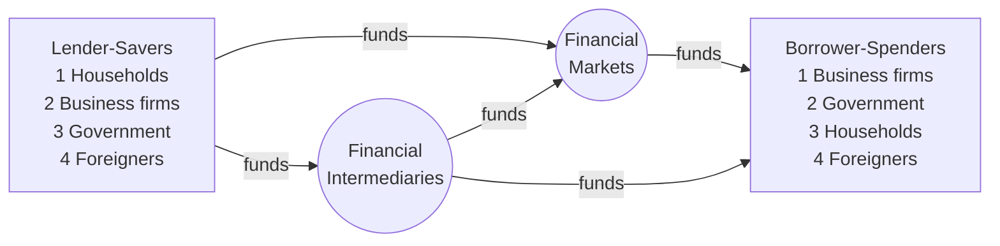

# 01 — The Financial System (ระบบการเงิน)

Slides 2–5, 11–12 · Mishkin Ch. 2 · CFA LM1 §2

This file is mostly conceptual. It sets up the vocabulary and the data context for the later models. Only §1.5 has formulas.

---

## 1.1 Direct and indirect finance

**Intuition.** Financial markets move funds from people who have more than they need (lender-savers, ผู้ออมเงิน) to people who need more than they have (borrower-spenders: investors, and people borrowing to consume). This raises efficiency because money goes to its most productive use.

- **Direct finance:** borrowers sell securities straight to lenders in financial markets (e.g., a company issues bonds or shares).
- **Indirect finance:** a financial intermediary (bank, insurer, fund) sits in between. It takes deposits or premiums and lends or invests them.

Mishkin's reasons intermediaries exist (useful context, not modeled): lower transaction costs, risk sharing, and reducing asymmetric information (adverse selection before the deal, moral hazard after it).

## 1.2 Market structure (Mishkin Ch. 2)

| Dimension | Types | Notes for modeling |
|---|---|---|
| Claim type | **Debt** (fixed payments, has a maturity) vs **Equity** (residual claim, no maturity) | Valued in `03` vs `04` |
| Issue stage | **Primary** (new issue) vs **Secondary** (resale) | Prices we observe are secondary-market prices |
| Venue | **Exchange** vs **OTC** | Thai bonds trade mostly OTC (ThaiBMA); stocks trade on the SET |
| Maturity | **Money market** (< 1 year) vs **Capital market** (≥ 1 year) | T-bills are money market; 10Y government bonds are capital market |

## 1.3 Key definitions (slide 4, 11)

- **Security (หลักทรัพย์):** a claim on the issuer's future income or assets.
- **Bond (พันธบัตร / หุ้นกู้):** a *debt security*. It is a loan contract that pays back on a set schedule.
- **Interest rate (อัตราดอกเบี้ย):** the cost of borrowing funds through the debt market. Its precise economic measure is the **yield to maturity** (see `03`).
- **Common stock (หุ้นสามัญ):** an *equity security*. It represents part-ownership of a company and a claim on its income and assets, in proportion to the shares held.

## 1.4 Thai rate landscape (slide 5) — data context

The slide plots Bank of Thailand series for 2005–2014:

| Series (Thai label) | English | Role in models |
|---|---|---|
| อัตราดอกเบี้ยนโยบาย | Policy rate | Anchor for short rates |
| อัตราดอกเบี้ยเงินกู้ยืมข้ามคืนระหว่างธนาคาร | Interbank overnight rate | Tracks the policy rate closely |
| ผลตอบแทนตั๋วเงินคลัง/พันธบัตรรัฐบาล 3 เดือน, 1 ปี, 10 ปี | Gov. yields 3M, 1Y, 10Y | Risk-free curve; the 10Y is the CAPM $r_f$ proxy (slide 25) |
| อัตราดอกเบี้ยเงินกู้ลูกค้ารายใหญ่ชั้นดี (MLR) ต่ำสุด | Minimum loan rate | Lending rate = risk-free + credit and bank margin |
| อัตราดอกเบี้ยเงินฝากออมทรัพย์ สูงสุด | Max savings deposit rate | Deposit rate, lowest line |

What the chart shows:

1. Short rates (policy, interbank, 3M, 1Y) move together.
2. The 10Y yield usually sits above the short rates. This gap is the maturity premium, i.e., an upward-sloping yield curve.
3. The MLR sits well above government yields. This gap is the default and intermediation premium.
4. All the rates fell together in 2009, after the global financial crisis.

Slide 12 shows the SET index alongside SET market cap, 1988–2013. The 1997 crash and the 2008 dip mark regime changes in equity risk.

## 1.5 What an interest rate is made of — rate build-up [extension, CFA LM1]

**Formula.**

$$ r = r^{real}_{f} + \pi^{premium} + DRP + LP + MP $$

- $r^{real}_f$ — real risk-free rate (pure time preference)
- $\pi^{premium}$ — expected-inflation premium; with it, $(1+r^{nom}_f) = (1+r^{real}_f)(1+\pi)$
- $DRP$ — default-risk premium (credit spread)
- $LP$ — liquidity premium
- $MP$ — maturity premium

**Link to repo data.** `data/CorporateAverageSpread(duration|ttm)_2026-08-26.xlsx` holds ThaiBMA average corporate spreads (bp) over government yields by rating (AAA … BBB−) and bucket (≤3Y, 3–5Y, >5Y). Those spreads are an empirical $DRP + LP$. A corporate bond's discount rate is:

$$ y_{corp}(T, \text{rating}) = y_{gov}(T) + \frac{\text{spread}_{bp}(T,\text{rating})}{10{,}000} $$

**Implementation notes.**
- `load_spreads(path) -> DataFrame` indexed by rating, with columns `["<=3", "3-5", ">5"]`, values in bp. The Excel file has a 2-row header: row 0 = metric group (Averaged Spread / Std Dev / Averaged Maturity), row 1 = bucket.
- `spread_for(rating, maturity_years, table) -> float` returns a decimal. Pick the bucket by maturity. Some cells are NaN (e.g., BBB >5Y); raise an error or fall back to the nearest bucket, and log a warning.

**Notebook ideas (NB01).**
- Plot the BOT policy rate and the 3M / 1Y / 10Y government yields, MLR, and deposit rate. Compute the term spread (10Y − 3M) and the bank spread (MLR − 1Y).
- Plot spread vs rating and maturity bucket as a heatmap, with the std-dev table as error bars.
