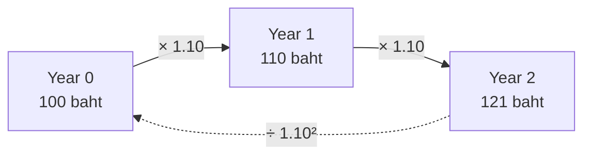

# 02 — Time Value of Money (ดอกเบี้ยทบต้น และแนวคิด Present Value)

Slides 6–10 · Mishkin Ch. 4 · CFA LM1 §5, LM2 §2–4

Everything else in this pack is built on this file. Implement it first, as `valuation/tvm.py`.

---

## 2.1 Why money has time value

**Intuition (slide 6).** The benefits and costs of lending happen at different times. To compare them, we bring them to the same point in time. 100 baht today is worth more than 100 baht in one year, because today's 100 baht can be invested (risk-free, by assumption) and will grow to more than 100 baht.



At $i = 10\%$: 100 today ≡ 110 at year 1 ≡ 121 at year 2 (slides 7–9).

## 2.2 Compounding and discounting — single cash flow

**Formula (slide 10, Mishkin eq. 1).**

$$ FV = PV\,(1+i)^t \qquad\Longleftrightarrow\qquad PV = \frac{FV}{(1+i)^t} $$

- Compounding (ทบต้น): $PV \to FV$. Discounting (คิดลด): $FV \to PV$.
- $\frac{1}{(1+i)^t}$ is the **discount factor** $DF_t$. The existing `pv.ipynb` already has `discount_factors()`.

**Implementation.**
```python
def fv(pv: float, rate: float, t: float, m: int = 1) -> float: ...
def pv(fv: float, rate: float, t: float, m: int = 1) -> float: ...
def discount_factor(rate: float, t: float | np.ndarray, m: int = 1) -> float | np.ndarray: ...
```
`t` may be fractional. `rate` may be negative (negative-yield bonds exist), but `1 + rate/m > 0` must hold.

**Tests.**
| Case | Inputs | Answer |
|---|---|---|
| Slide 6 | 100, 10%, 1y | FV = 110 |
| Slide 8 | 100, 10%, 2y | FV = 121 |
| Mishkin App. "Simple PV" | FV 250, 15%, 2y | PV = 189.04 |
| CFA LM2 Ex 1 | FV 100, 6.7%, 20y | PV = 27.33 |
| CFA LM2 Ex 1 (neg. rate) | FV 100, −0.05%, 10y | PV = 100.50 |

## 2.3 Multiple cash flows — the PV of a stream

**Formula (cash-flow additivity).**

$$ PV = \sum_{t=1}^{n} \frac{CF_t}{(1+i)^t} $$

The PV of a stream is the sum of the PVs of its parts. This is the **cash-flow additivity principle**. It is also the reason a no-arbitrage price exists: two portfolios with identical cash flows must have the same price.

**Implementation.**
```python
def pv_stream(cfs: ArrayLike, rate: float | ArrayLike, times: ArrayLike | None = None, m: int = 1) -> float:
    """times default = 1..n periods. rate may be a vector (spot curve) -> discount each CF at its own rate."""
def npv(rate, cfs, t0_included=True) -> float   # CF_0 at t=0 undiscounted
def irr(cfs, lo=-0.99, hi=1.0) -> float       # root of npv; use scipy.optimize.brentq, fall back to bisection
```
Allowing `rate` to be a vector matters later: discounting each CF at its own spot rate $z_t$ is the arbitrage-free bond price.

**Test — the lottery (Mishkin).** A 20-million "jackpot" is paid as 1M per year for 20 years, with the first payment today, at $i = 10\%$. PV = **9.365M** (Mishkin says "≈ 9.4 million"). This is an annuity *due*: the payments fall at $t = 0..19$.

## 2.4 Compounding frequency, EAR, continuous compounding [CFA LM1 §5]

**Formula.** For a quoted annual rate $R_s$ compounded $m$ times a year over $N$ years:

$$ PV = FV_N\left(1+\frac{R_s}{m}\right)^{-mN}, \qquad EAR = \left(1+\frac{R_s}{m}\right)^m - 1, \qquad \lim_{m\to\infty}: \; FV = PV\,e^{R_s N} $$

- **Periodic rate** = $R_s/m$. **Number of periods** = $mN$. Always convert both together. This is why `pv.ipynb` uses `ytm / freq` and `months * freq / 12`.
- **Continuously compounded (log) return:** $r_{0,T} = \ln(P_T/P_0) = \ln(1+R)$. Log returns **add up** over time: $r_{0,T} = \sum r_{t-1,t}$.

**Annualizing a holding-period return.** $R_{annual} = (1+R_{period})^{c} - 1$, where $c$ = periods per year. For example, $c = 365/\text{days}$, or $c = 2/3$ for an 18-month return.

**Tests.**
| Case | Answer |
|---|---|
| CAD 5,000,000 in 10y, 6% compounded monthly → PV | 2,748,163.67 |
| Weekly 0.2% → annual | 10.95% |
| 18-month 20% → annual | 12.92% |
| 100-day 6.2% → annual (365/100) | 24.55% |
| Price 30 → 34.50, log return | 0.139762 |

## 2.5 Annuities and fixed payments

**Formula.** Level payment $A$ for $n$ periods at periodic rate $r$:

$$ PV = A\cdot\frac{1-(1+r)^{-n}}{r} \qquad\Longleftrightarrow\qquad A = \frac{r\cdot PV}{1-(1+r)^{-n}} $$

Annuity due (payments at the start of each period) $= $ ordinary annuity $\times (1+r)$.

**Implementation.** `annuity_pv(A, r, n, due=False)`, `annuity_payment(pv, r, n)`, `annuity_rate(pv, A, n)` (root-find). Handle `r == 0` separately: then $PV = A\cdot n$.

**Tests.**
| Case | Answer |
|---|---|
| Mishkin: loan 100,000, 7%, 20y, yearly payment | 9,439.29 |
| Mishkin: loan 1,000, payment 85.81, 25y → rate | 7.00% |
| CFA: mortgage 800,000, 5.25%/12, 360 months → payment | 4,417.63 |

## 2.6 Perpetuity and growing perpetuity

**Formula.**

$$ PV_{perp} = \frac{C}{i} \qquad\qquad PV_{growing} = \frac{C_1}{i-g}\quad (i>g) $$

Derivation (Mishkin ch. 4, fn. 3): let $x = 1/(1+i)$. Then $P = C(x+x^2+\dots) = C\left(\frac{1}{1-x}-1\right) = C/i$.

The growing perpetuity is the **Gordon growth model** in `04`. It is the same math applied to dividends.

**Implementation.** `perpetuity_pv(c, rate)`, `growing_perpetuity_pv(c1, rate, g)`. Raise `ValueError` if `rate <= g`.

**Tests.** Perpetuity 100/yr at 10% → 1,000; at 20% → 500. Price 2,000 and coupon 100 → yield 5%.

## 2.7 Spot rates and implied forward rates [extension, CFA LM2 §4]

**Formula.** With annual spot (zero) rates $z_t$, no-arbitrage requires:

$$ (1+z_2)^2 = (1+z_1)(1+f_{1,1}) \;\Rightarrow\; f_{1,1} = \frac{(1+z_2)^2}{(1+z_1)} - 1 $$

In general: $(1+z_B)^{B} = (1+z_A)^{A}\,(1+f_{A,B-A})^{B-A}$.

**Implementation.** `forward_rate(z_a, a, z_b, b)`.

**Test.** $z_1 = 2\%$, $z_2 = 3\%$ → $f_{1,1} = 4.0098\%$.

## 2.8 Notebook (NB02 `tvm.ipynb`)

1. Reproduce the 100 → 110 → 121 timeline as a table and bar chart.
2. Plot PV of 100 vs $t$ (0–30y) for $i \in \{2, 5, 10\}\%$: discounting decays exponentially.
3. Plot EAR vs compounding frequency $m \in \{1, 2, 4, 12, 365, \infty\}$.
4. Build an amortization schedule for the CFA mortgage (month, payment, interest, principal, balance). Assert month-1 interest = 3,500.00 and month-2 interest = 3,495.99, and that the final balance is 0.
