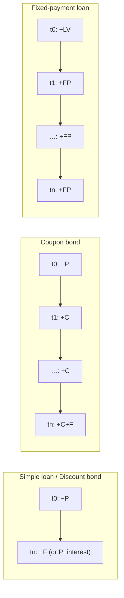

# 03 — Debt Instruments, Yields, and Interest-Rate Risk (ตลาดตราสารหนี้)

Slides 4, 6–10 · Mishkin Ch. 4 · CFA LM2 §2–3

Implement as `valuation/bonds.py`. The repo's `pv.ipynb` already has a quarterly coupon pricer with coupon tax and a bisection IRR. Refactor it into this module and keep the same argument names (`par, coupon_rate, months, freq, ytm, tax_rate`).

---

## 3.1 The four credit-market instruments

| Type | Cash flows | Examples | Price formula |
|---|---|---|---|
| **Simple loan** | Principal out at $t=0$; principal + interest back at maturity | Short-term commercial loan | $PV = \frac{CF}{(1+i)^n}$ |
| **Fixed-payment (fully amortized) loan** | Same payment every period, mixing interest and principal | Mortgage, auto loan | $LV = \sum_{t=1}^{n}\frac{FP}{(1+i)^t}$ |
| **Coupon bond** | Coupon $C$ every period, plus face value $F$ at maturity | Government and corporate bonds | $P = \sum_{t=1}^{n}\frac{C}{(1+i)^t} + \frac{F}{(1+i)^n}$ |
| **Discount (zero-coupon) bond** | Bought below face; pays $F$ at maturity, nothing before | T-bills (ตั๋วเงินคลัง), strips | $P = \frac{F}{(1+i)^n}$ |



A coupon bond is identified by four facts: face value, issuer, maturity date, and **coupon rate** = $C/F$.

## 3.2 Yield to maturity (YTM)

**Intuition.** The YTM is the single interest rate that makes the PV of all promised cash flows equal to today's price. It is the bond's **internal rate of return**, and economists treat it as *the* interest rate. It assumes the bond is held to maturity, every payment is made, and coupons are reinvested at the YTM.

**Formula.** Solve for $i$:

$$ P = \sum_{t=1}^{nm}\frac{C/m}{(1+i/m)^t} + \frac{F}{(1+i/m)^{nm}} $$

There is no closed form for $n > 1$ coupon periods. Use a root finder.

**Closed forms that do exist.**
- Simple loan / 1-year discount bond: $i = \frac{F-P}{P}$ (Mishkin eq. 6). For $n$ years: $i = (F/P)^{1/n}-1$.
- Perpetuity (consol): $i_c = C/P_c$.

**Implementation.**
```python
def bond_cash_flows(par, coupon_rate, months, freq) -> tuple[np.ndarray, np.ndarray]:
    """returns (times_in_years, cash_flows). Matches pv.ipynb periods()/cash_flows()."""
def bond_price(par, coupon_rate, months, ytm, freq=1, tax_rate=0.0) -> float
def bond_ytm(price, par, coupon_rate, months, freq=1, tax_rate=0.0) -> float
    # brentq on f(y)=bond_price(y)-price, bracket (-freq+1e-9, 1.0); widen hi if needed
def zero_price(face, ytm, t, m=1) -> float
def zero_ytm(price, face, t) -> float      # closed form
```
**Edge cases.** Price at par ⇒ YTM = coupon rate (on a coupon date). Allow negative yields. The bracket lower bound must keep $1 + y/m > 0$.

**Tests.**
| Case | Answer |
|---|---|
| 10% coupon, F=1000, 8y, YTM 12.25% → price | 889.20 |
| Mishkin Table 1 — 10% coupon, 10y, F=1000: price 1200 / 1100 / 1000 / 900 / 800 → YTM | 7.13 / 8.48 / 10.00 / 11.75 / 13.81 % |
| 1y T-bill F=1000 at 900 → YTM | 11.1% |
| … at 950 → YTM | 5.3% |
| CFA Greek 2% annual, 7y, at YTM 2% → price | 100.00 |
| Same bond two years later at 93.091 (5y left) → YTM | 3.532% |
| CFA India 6.7% semiannual, 20y, YTM 7.70% → price | 89.88 |
| Zero F=100, 20y at 6.7%: annual vs semiannual compounding | 27.33 vs 26.77 |
| KB perpetual, 3.30% quarterly coupon, price 97.03 → annual yield | 3.40% |
| Zero 22.68224 → 100 in 20y → YTM | 7.70% |

## 3.3 Three facts about price and yield (Mishkin)

1. **Price at par ⇔ YTM = coupon rate.**
2. **Price and YTM move in opposite directions.** A higher $i$ raises every denominator.
3. **Discount bond** ($P < F$) ⇒ YTM > coupon rate. **Premium bond** ($P > F$) ⇒ YTM < coupon rate.

Test 1 and 2 in code. Plot price vs yield; the curve is downward-sloping and **convex**. The existing `curve` DataFrame in `pv.ipynb` already does this.

## 3.4 Current yield (อัตราผลตอบแทนปัจจุบัน)

**Formula.** $i_c = \dfrac{C}{P}$

Current yield is an approximation to YTM. It is good for long maturities (≥ 20y) and for prices near par, because a long bond behaves like a perpetuity. It ignores capital gains and losses toward par.

**Test.** 10% coupon, 20y, YTM 12% → price 850.61 → current yield 11.76%. That is close to 12%, but it is not 12%.

## 3.5 Return vs interest rate (rate of return ≠ YTM)

**Formula (Mishkin eq. 7–8).** One-period holding return:

$$ R = \frac{C + P_{t+1} - P_t}{P_t} = \underbrace{\frac{C}{P_t}}_{i_c\ \text{current yield}} + \underbrace{\frac{P_{t+1}-P_t}{P_t}}_{g\ \text{rate of capital gain}} $$

**Intuition.** YTM is what you *expect* when you buy and hold to maturity. Return is what you *actually get* over your holding period. They are equal only when the holding period equals the time to maturity (strictly, only for zeros, because of reinvestment).

**Tests.**
- Buy at 1000, coupon 100, sell at 1200 → $R$ = 30%, even though the YTM was 10%.
- **Mishkin Table 2.** 10% coupon bonds bought at par (YTM 10%). Rates rise to 20% after one year. Next-year price = a bond with (n−1) years left, priced at a 20% yield.

| Years to maturity | $P_{t+1}$ | Capital gain | Return |
|---|---|---|---|
| 30 | 503 | −49.7% | −39.7% |
| 20 | 516 | −48.4% | −38.4% |
| 10 | 597 | −40.3% | −30.3% |
| 5 | 741 | −25.9% | −15.9% |
| 2 | 917 | −8.3% | +1.7% |
| 1 | 1000 | 0.0% | +10.0% |

**Implementation.** `holding_period_return(p0, p1, income=0.0)` and `table2(coupon_rate=.10, y0=.10, y1=.20, maturities=[30,20,10,5,2,1])`. The second returns this table exactly (rounded to the nearest unit).

## 3.6 Interest-rate risk and reinvestment risk

- **Interest-rate risk.** The longer the maturity, the larger the price swing for a given rate change. Bonds whose maturity equals the holding period carry no interest-rate risk (Table 2, last row).
- **Reinvestment risk** (Mishkin fn. 6). If the holding period is *longer* than maturity, you must roll over at unknown future rates. Example: a 2-year horizon rolling 1-year bonds starting at 10%. If rates go to 20%, you end with 1,320, i.e., 14.9% per year. If rates go to 5%, you end with 1,155, i.e., 7.47% per year. (Mishkin prints 7.2%; recomputing $\sqrt{1.155}-1$ gives 7.47%.) Here the investor *gains* when rates rise.
- **Implementation.** `rollover_value(principal, rates: list[float])`, then annualize with `(V/P)**(1/n) - 1`.

## 3.7 Duration and convexity — measuring interest-rate risk [extension]

Mishkin points to an online appendix for these. Standard formulas, with $y$ = YTM, $m$ = frequency, $k$ = period index, $t_k = k/m$:

$$ D_{mac} = \frac{1}{P}\sum_k t_k\,\frac{CF_k}{(1+y/m)^k}, \qquad D_{mod} = \frac{D_{mac}}{1+y/m} $$

$$ \text{Convexity} = \frac{1}{P\,(1+y/m)^2\,m^2}\sum_k \frac{CF_k\,k(k+1)}{(1+y/m)^k} $$

$$ \frac{\Delta P}{P} \approx -D_{mod}\,\Delta y + \tfrac12\,\text{Convexity}\,(\Delta y)^2 $$

**Tests.** 10% annual coupon, 10y, priced at par (y = 10%): $D_{mac}$ = 6.759, $D_{mod}$ = 6.145, convexity = 52.79. For +100bp, the approximation gives −5.881%, and the exact repricing gives −5.889%.

**Implementation.** `duration(...) -> dict(macaulay, modified, convexity, dv01)`, where `dv01 = D_mod * P * 0.0001`. Check it against finite differences: $(P(y-h)-P(y+h))/(2hP)$.

## 3.8 Real vs nominal interest rates (Fisher equation)

**Formula (Mishkin eq. 9–10, fn. 7–8).**

$$ i = r + \pi^e \quad(\text{approx.}), \qquad (1+i) = (1+r)(1+\pi^e) \quad(\text{exact}) $$

$$ r_{after\text{-}tax} = i(1-\tau) - \pi^e $$

- **Ex ante real rate:** uses *expected* inflation. This rate drives decisions.
- **Ex post real rate:** uses *actual* inflation. It measures how a lender actually did.

**Tests.** $i$ = 5%, $\pi^e$ = 3% → $r$ = 2%. $i$ = 8%, $\pi^e$ = 10% → $r$ = −2%. $i$ = 10%, $\tau$ = 30%, $\pi^e$ = 5% → after-tax real = 2%. CFA: after-tax nominal 2.4%, inflation 2% → exact real 0.39%.

**Implementation.** `real_rate(nominal, infl, exact=True)` and `after_tax_real(nominal, tax, infl)`.

## 3.9 Taxes on coupons (matches the existing `pv.ipynb`)

Thai withholding tax on bond interest for individuals is 15%. The notebook models the after-tax cash flow as $CF_k - \tau\cdot C/m$, so tax applies to the coupon only and the principal is untaxed. Keep this convention and document it. The after-tax YTM is the IRR of these after-tax cash flows.

## 3.10 Credit spreads and corporate bonds

Discount at $y_{gov}(T) + s(\text{rating}, T)$ using the repo's ThaiBMA spread table (see `01` §1.5). Notebook task: price the same 5-year 3% bond for each rating AAA…BBB− and plot price vs rating.

## 3.11 Notebook (NB03 `bonds.ipynb`)

1. Refactor `pv.ipynb` functions into `valuation/bonds.py` and import them.
2. Reproduce Tables 1 and 2 and assert the values above.
3. Price–yield curve with the duration tangent line and the convexity quadratic, plus an error plot.
4. Return vs YTM: simulate parallel rate shocks of ±100/200/300bp and show 1-year returns by maturity.
5. Real-rate chart: Thai 1Y yield minus CPI inflation (ex post), if data is available.
6. Corporate pricing by rating using the spread table.
