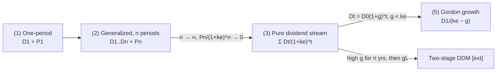

# 04 — Common Stock Valuation (การคำนวณหาราคาของหุ้นสามัญ)

Slides 11, 13–17 · Mishkin Ch. 7 · CFA LM2 §2–3

Implement as `valuation/equity.py`. The discount rate $k_e$ comes from CAPM (`05`).

---

## 4.1 Basic principle

> **Value of an investment = PV of its expected future cash flows** (slide 13).

For a shareholder, the only cash flows are **dividends** plus the **sale price** when they eventually sell. The discount rate is the **required return on equity $k_e$**, not the bond interest rate.



## 4.2 One-period valuation model — eq. (1)

$$ P_0 = \frac{D_1}{1+k_e} + \frac{P_1}{1+k_e} $$

**Test (Mishkin).** Intel: $D_1$ = 0.16, $P_1$ = 60, $k_e$ = 12% → $P_0$ = 0.14 + 53.57 = **53.71**. The market price is 50 < 53.71, so the model says *buy*.

## 4.3 Generalized dividend valuation model — eq. (2), (3)

$$ P_0 = \sum_{t=1}^{n}\frac{D_t}{(1+k_e)^t} + \frac{P_n}{(1+k_e)^n} \;\xrightarrow{\,n\to\infty\,}\; P_0 = \sum_{t=1}^{\infty}\frac{D_t}{(1+k_e)^t} $$

**Intuition.** If $P_n$ is far enough in the future, its PV is negligible. So the price depends *only* on the dividend stream. Stocks that pay no dividends today have value because the market expects dividends later.

**Test.** PV of 50 received in 75 years at 12% = 0.0102 (about one cent). Mishkin's text prints 0.014; recomputation gives 0.0102. Use **0.0102**.

**Implementation.** `ddm_explicit(dividends: ArrayLike, ke: float, terminal_price: float = 0.0) -> float`. This reuses `tvm.pv_stream`.

## 4.4 Gordon growth model — eq. (4), (5)

$$ P_0 = \sum_{t=1}^{\infty}\frac{D_0(1+g)^t}{(1+k_e)^t} = \frac{D_0(1+g)}{k_e-g} = \frac{D_1}{k_e-g}, \qquad k_e > g $$

**Derivation (Mishkin fn. 1).** Multiply eq. (4) by $(1+k_e)/(1+g)$, subtract eq. (4), drop the vanishing term (it vanishes because $k_e > g$), and solve: $P_0\frac{k_e-g}{1+g} = D_0$.

**Assumptions.** (1) Dividends grow at a constant rate forever. (2) $g < k_e$; otherwise the firm would eventually grow infinitely large and the sum diverges.

**Implementation.**
```python
def gordon_price(ke, g, d1=None, d0=None) -> float   # exactly one of d0/d1; raise if ke <= g
def gordon_implied_return(price, d1, g) -> float      # ke = D1/P0 + g   (dividend yield + growth)
def gordon_implied_growth(price, d1, ke) -> float     # g  = ke − D1/P0
```

**Tests.**
| Case | Answer |
|---|---|
| CFA Shipline constant dividend 1.50, $k_e$ 15%, g = 0 | 10.00 |
| Shipline $D_0$ 1.50, g 6%, $k_e$ 15% | 17.67 |
| Mishkin: $D_1$ = 2, g = 3%, $k_e$ = 15% / 12% / 10% | 16.67 / 22.22 / 28.57 |
| Coke: P 63, $D_1$ 1.76, g 4% → implied $k_e$ | 6.79% |
| Coke: P 63, $D_1$ 1.76, $k_e$ 7% → implied g | 4.21% |

## 4.5 Two-stage dividend discount model [extension, CFA LM2 eq. 15–17]

$$ P_0 = \sum_{t=1}^{n}\frac{D_0(1+g_S)^t}{(1+k_e)^t} + \frac{1}{(1+k_e)^n}\cdot\underbrace{\frac{D_n(1+g_L)}{k_e-g_L}}_{\text{terminal value } P_n} $$

**Test (CFA Shipline).** $D_0$ = 1.50, $g_S$ = 6% for 3y, $k_e$ = 15%:

| $g_L$ | 0% | 2% | 4% | 6% |
|---|---|---|---|---|
| Price | 11.66 | **13.05** | 14.94 | 17.67 |

The 2% case breaks down as PV(stage 1) 3.832 + PV(terminal) 9.22.

**Implementation.** `two_stage_ddm(d0, g_short, n, g_long, ke)`. Generalize to `multi_stage_ddm(d0, growth_path: list[float], g_terminal, ke)`.

## 4.6 Price-to-earnings link [extension, CFA LM2 eq. 23–24]

$$ \frac{P_0}{E_1} = \frac{D_1/E_1}{k_e - g} \quad(\text{forward P/E} = \text{payout ratio}/(k_e-g)) $$

**Tests.** P/E 28, payout 70%, g 4% → $k_e$ = 6.50%. P/E 28, payout 70%, $k_e$ 6.5% → g = 4.00%. Index P/E 19, payout 60%, $k_e$ 8% → g = 4.84%. Payout 70%, $k_e$ 9%, g 4.5% → justified P/E = 15.56. That is below 28, so the stock looks overvalued.

## 4.7 How the market sets stock prices — why prices move (slides 16–17)

**Intuition (Mishkin auction example).**
- The price is set by the buyer willing to pay the most, i.e., the one who can make the best use of the asset or who has the **best information**.
- Better information means lower perceived risk, a lower $k_e$, and a higher valuation.
- Mishkin's example: the same stock with $D_1$ = 2 and g = 3% is worth 16.67 / 22.22 / 28.57 to investors requiring 15% / 12% / 10%. The market price ends up between 22.22 and 28.57: the lowest-risk investor sets it.

**Why prices are volatile.** New information (company news, macro data, foreign events) changes expected dividends ($D$, $g$) or their risk ($k_e$), so $P_0$ changes. Gordon makes this sensitivity explicit:

$$ \frac{\partial P_0}{\partial g} = \frac{D_1}{(k_e-g)^2} > 0, \qquad \frac{\partial P_0}{\partial k_e} = -\frac{D_1}{(k_e-g)^2} < 0 $$

Both blow up as $k_e - g \to 0$. That is why small changes in assumptions move prices a lot.

**Applications.**
- *Monetary policy:* a rate cut lowers $k_e$ (bonds become less attractive) and raises $g$ (stronger economy), so $P_0$ rises.
- *Global financial crisis:* $g$ fell and $k_e$ rose (wider credit spreads), so $P_0$ crashed. The DJIA fell 53% from Oct-2007 to Mar-2009.
- *Slide 16 question:* "What $g$ is right for PTT stock?" → notebook exercise: back out the implied $g$ from PTT's price, dividend, and a CAPM $k_e$.

## 4.8 Notebook (NB04 `equity_ddm.ipynb`)

1. Implement the one-period, explicit-n, Gordon, and two-stage models. Assert all tests.
2. Show convergence: the explicit DDM with a growing dividend for n = 10, 50, 100, 500 approaches the Gordon value.
3. Sensitivity heatmap of $P_0$ over $k_e \in [6\%,16\%]$ × $g \in [0\%,6\%]$; mask $g \ge k_e$.
4. "Who sets the price": three investors with different $k_e$, showing the resulting bid ladder.
5. Thai case (e.g., PTT or another SET dividend payer): get price and trailing DPS, take $k_e$ from NB05 CAPM, and back out the implied $g$. Compare it with historical dividend growth.
