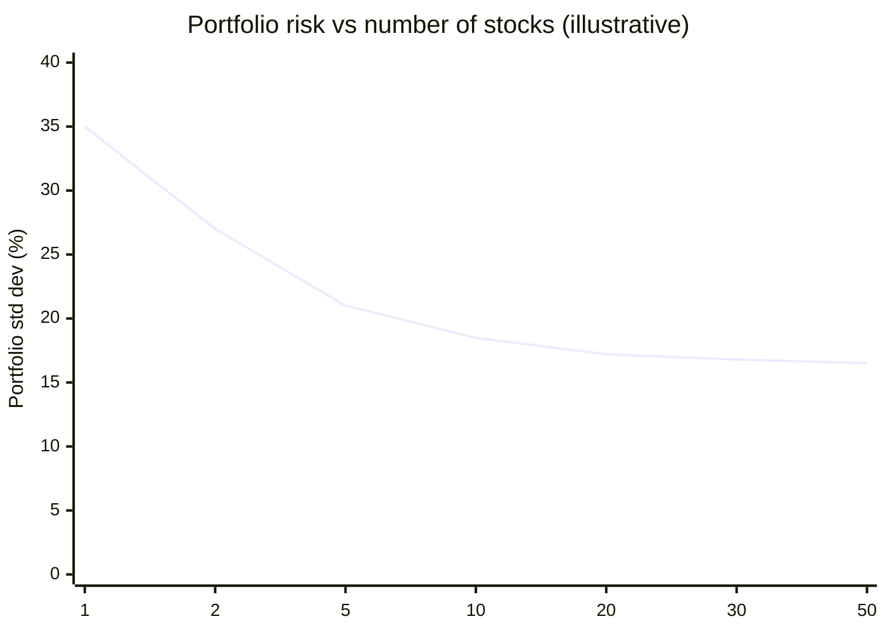
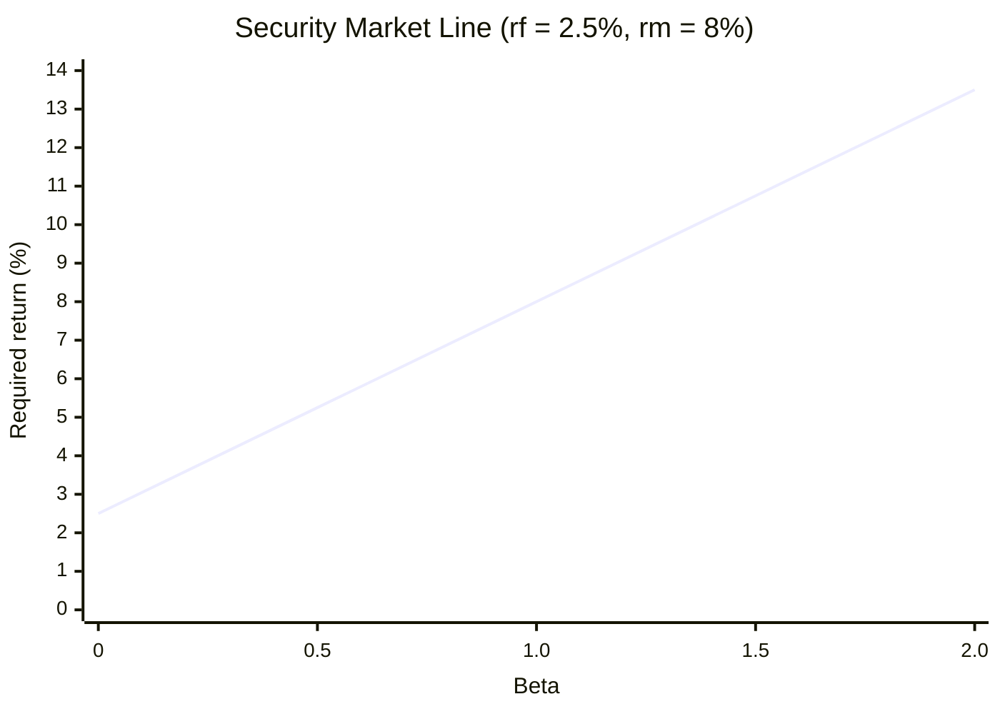
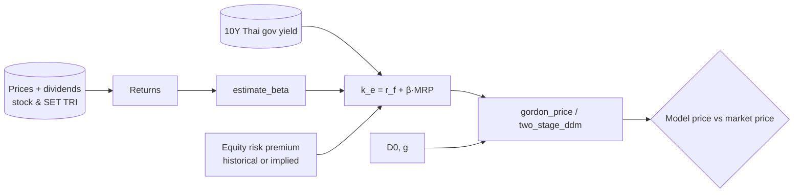

# 05 — Returns, Risk, and the Capital Asset Pricing Model (CAPM)

Slides 21–29 · Sharpe (1970) as cited on the slides · CFA LM1, LM3, LM5, LM10

Implement as `valuation/returns.py` and `valuation/capm.py`. CAPM gives the $k_e$ used in `04`.

---

## 5.1 Return measures [CFA LM1]

| Measure | Formula | Use |
|---|---|---|
| Holding-period return | $R = \frac{P_1 - P_0 + D_1}{P_0}$ | Basic return (same as Mishkin eq. 7) |
| Arithmetic mean | $\bar R = \frac1T\sum R_t$ | Expected one-period return, CAPM inputs |
| Geometric mean | $\bar R_G = \left[\prod(1+R_t)\right]^{1/T}-1$ | Realized compound growth |
| Log return | $r_t = \ln(P_t/P_{t-1})$ | Additive over time; use for regressions and EMH tests |
| Annualized | $(1+R_{period})^{c}-1$ | Comparability |
| Excess return | $R_t - r_{f,t}$ | CAPM regression |
| Leveraged return | $R_L = R_P + \frac{V_B}{V_E}(R_P - r_D)$ | Test: $R_P$ 8%, 30% debt at 5% → 9.29% |

Dividends must be included. For Thai stocks, use a total-return series (price + dividends). For the market, use the SET TRI, not the SET index.

## 5.2 Mainstream view of risk (slide 29)

1. Investors maximize **expected utility** under risk. They are risk-averse.
2. Returns differ across assets mainly because of risk. The extra return over the risk-free rate is the **risk premium**.
3. For stocks there are two specific theories: **CAPM** (which risk is priced) and the **EMH** (prices reflect information; see `06`).

## 5.3 Systematic vs unsystematic risk (slides 22–23)

- **Systematic (market) risk — ความเสี่ยงที่เป็นระบบ.** Market-wide shocks such as rate changes, recessions, and wars. It **cannot** be diversified away, even if you hold every stock.
- **Unsystematic (specific) risk — ความเสี่ยงเฉพาะ.** Risk tied to one firm: the part of its return that does not move with the market. It **can** be diversified away by holding more stocks.
- So only systematic risk should earn a premium. CAPM measures it with **beta**.

**Variance decomposition (single-index / market model).**

$$ R_{i,t} - r_f = \alpha_i + \beta_i (R_{m,t}-r_f) + \varepsilon_{i,t} \;\Rightarrow\; \sigma_i^2 = \underbrace{\beta_i^2\sigma_m^2}_{\text{systematic}} + \underbrace{\sigma_\varepsilon^2}_{\text{unsystematic}} $$

**Diversification (equal-weighted portfolio of N stocks) [CFA LM5].**

$$ \sigma_p^2 = \frac{1}{N}\bar\sigma^2 + \frac{N-1}{N}\,\overline{\text{cov}} \;\xrightarrow{N\to\infty}\; \overline{\text{cov}} $$

The floor $\overline{\text{cov}}$ is the systematic risk that cannot be diversified away.



**Implementation.** `portfolio_variance(w, cov)` = $w^\top\Sigma w$, and `diversification_curve(returns_df, n_max, n_sims=500)`, which draws random equal-weight portfolios of size N and averages their std dev.

## 5.4 CAPM equation (slides 24–28)

$$ r_a = r_f + \beta_a\,(r_m - r_f) $$

| Symbol | Meaning (slide) |
|---|---|
| $r_a$ | expected return on stock A (the required return / cost of equity, i.e., $k_e$) |
| $r_f$ | risk-free rate. The slide suggests the **10-year government bond yield** as a proxy |
| $\beta_a$ | beta of stock A |
| $r_m$ | expected return on the market |
| $r_m - r_f$ | **equity (market) risk premium** |

**Three readings of the same equation.**
1. **Cost of funds (slide 24).** The return on a stock or portfolio should equal the cost of financing that investment.
2. **Equity premium view (slide 25).** Start from $r_f$, then add the market premium scaled by beta, which compensates for extra risk.
3. **Reward-to-risk equality (slide 27).** $\dfrac{r_a - r_f}{\beta_a} = r_m - r_f$. After adjusting for its own beta, every stock's excess return per unit of risk equals the market's. This ratio is the **Treynor ratio**, and the equality defines the **Security Market Line (SML)**.



## 5.5 Beta (slide 26)

**Meaning.** Beta is the *relative volatility* of a stock against the market, and the only priced risk measure under CAPM. β = 1 moves with the market. β = 1.5 moves +15% when the market moves +10%, and −15% when it moves −10%.

**Estimation [extension, CFA LM10 simple regression].**

$$ \hat\beta_i = \frac{\text{Cov}(R_i, R_m)}{\text{Var}(R_m)} = \rho_{i,m}\frac{\sigma_i}{\sigma_m} $$

OLS on excess returns: $R_i - r_f = \alpha + \beta (R_m - r_f) + \varepsilon$.

- **Jensen's alpha** $\alpha$: return beyond CAPM. Under CAPM plus the EMH, $\alpha$ should be ≈ 0 (see `06`).
- $R^2$: the share of variance that is systematic. $1 - R^2$ is the diversifiable share.
- **Practical conventions** (state them in the notebook): 60 monthly or 104–260 weekly returns; market = SET TRI; $r_f$ = 1M/3M T-bill converted to the return period for the regression. Report the standard error and t-stat of β.
- **Optional:** Blume-adjusted beta $= \tfrac23\hat\beta + \tfrac13$, and rolling 36-month beta.

**Implementation.**
```python
def capm_required_return(rf, beta, rm=None, mrp=None) -> float  # give rm or mrp
def estimate_beta(asset_ret, market_ret, rf=0.0) -> dict  # alpha, beta, se_beta, t_beta, r2, resid_std; statsmodels OLS
def rolling_beta(asset_ret, market_ret, window=36) -> pd.Series
def sml_alpha(realized_mean, rf, beta, rm) -> float   # realized − CAPM required
def treynor(mean_ret, rf, beta) -> float
```

**Tests.**
| Case | Answer |
|---|---|
| $r_f$ 2.5%, β 1.2, $r_m$ 8% → $r_a$ | 9.10% |
| β 1.5, market +10% → stock | +15% |
| Synthetic: $R_m \sim N(0.01, 0.04)$, $R_i = 0.002 + 1.3R_m + \varepsilon$, n = 5,000, seed 42 → $\hat\beta$ | ≈ 1.3 (within ±0.05) |
| `estimate_beta` vs `np.cov(ri, rm)[0,1]/np.var(rm, ddof=1)` | equal to 1e-10 |

## 5.6 CAPM → equity valuation pipeline



**Equity risk premium choices** (state them explicitly): (a) historical mean of $R_{SET\,TRI} - r_f$ (arithmetic); (b) implied from the index via Gordon: $MRP = D_1/P_{index} + g - r_f$.

## 5.7 Notebook (NB05 `capm.ipynb`)

1. Compute returns (simple and log) for 5–10 SET stocks and the SET TRI. Report summary stats: arithmetic and geometric means, std dev, annualized.
2. Diversification curve: portfolio std dev vs N.
3. Estimate β, α, and R² for each stock. Plot the characteristic line (scatter + fit).
4. Plot the SML with each stock's realized mean return; points above the line have positive alpha.
5. Systematic vs specific variance split per stock, as stacked bars.
6. Export each stock's $k_e$ for NB04.
