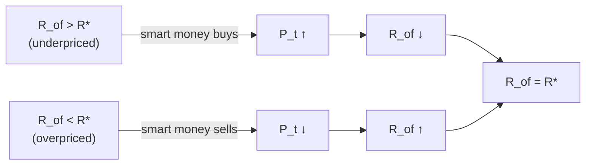

# 06 — Rational Expectations and the Efficient Market Hypothesis (ทฤษฎีตลาดมีประสิทธิภาพ)

Slides 18–20, 29 · Mishkin Ch. 7 · CFA LM8–9 (tests)

This file is mostly theory. The notebook part is **empirical tests** of efficiency on Thai data. Implement as `valuation/emh.py`.

---

## 6.1 Expectations: adaptive vs rational (Mishkin)

- **Adaptive expectations.** Expectations are a weighted average of past values: $\pi^e_t = (1-\lambda)\sum_{j=0}^{\infty}\lambda^j\pi_{t-j}$, with $0<\lambda<1$. They adjust slowly.
- **Rational expectations (Muth 1961).** Expectations equal **optimal forecasts using all available information**: $X^e = X^{of}$.
  1. If the way a variable moves changes, the way expectations of it are formed changes too.
  2. Forecast errors $X - X^e$ average **zero** and **cannot be predicted** in advance.

`adaptive_expectation(series, lam)` makes a nice small demo: compare adaptive and rational forecasts of a mean-reverting series.

## 6.2 EMH — definition (slide 18)

The prices of securities fully and quickly reflect all available information, so the price is "fair". It is therefore impossible to earn excess returns *consistently* (after adjusting for risk) using technical or fundamental analysis. When new information arrives, the price adjusts **immediately**.

**Formal condition (Mishkin eq. 7–10).** Return: $R = \frac{P_{t+1}-P_t+C}{P_t}$. With rational expectations, $R^e = R^{of}$. Market equilibrium gives $R^e = R^*$. So:

$$ R^{of} = R^* $$

The optimal forecast of a security's return equals its equilibrium (risk-justified) return. With CAPM as the equilibrium model: $R^* = r_f + \beta(r_m - r_f)$, so the expected **abnormal return (alpha) = 0**.

## 6.3 Why it holds — arbitrage



Not everyone needs to be informed. A few "smart money" traders are enough to eliminate **unexploited profit opportunities**.

## 6.4 Key ideas (slide 19)

1. **Prices reflect information:** past, current, and public information is already in the price.
2. **You cannot beat the market:** no consistent risk-adjusted outperformance.
3. **Best strategy:** buy an **index fund or ETF** to earn the market return, rather than picking stocks or timing the market.

Mishkin's practical corollaries: published adviser reports and hot tips have no edge. Prices don't always rise on good news, because what moves the price is *unexpected* news. Under efficiency, the investor should buy and hold a diversified portfolio.

## 6.5 Three forms (slide 20)

| Form | Price reflects | Implication | Empirical test (notebook) |
|---|---|---|---|
| **Weak** | All **past** price and volume data | Technical analysis cannot predict | Autocorrelation, Ljung–Box, runs test, variance ratio, simple trading-rule backtest vs buy-and-hold |
| **Semi-strong** | All **public** information (financial statements, news) | Fundamental analysis cannot find mispriced stocks | **Event study**: abnormal returns around announcements (earnings, dividends, BOT rate decisions) |
| **Strong** | All information, **public and private (insider)** | Nobody has an advantage | Insider-trade returns (data-heavy; discussion only) |

Each form nests the previous one: strong ⊃ semi-strong ⊃ weak.

## 6.6 Random walk

If prices follow a random walk, changes are unpredictable: $P_t = P_{t-1} + \varepsilon_t$, or in logs, $p_t = p_{t-1} + \mu + \varepsilon_t$, with $\varepsilon$ iid. Weak-form efficiency does **not** strictly require a pure random walk; it requires no *exploitable* predictability after costs and risk.

## 6.7 Test toolkit [extension]

**Autocorrelation.** $\hat\rho_k = \frac{\sum (r_t-\bar r)(r_{t-k}-\bar r)}{\sum (r_t-\bar r)^2}$. Under the null, $\hat\rho_k \sim N(0, 1/T)$. Ljung–Box $Q = T(T+2)\sum_{k=1}^{h}\frac{\hat\rho_k^2}{T-k} \sim \chi^2_h$.

**Runs test (Wald–Wolfowitz)** on the signs of returns. $n_+$, $n_-$ = counts, $n = n_+ + n_-$, and

$$ E[\text{runs}] = \frac{2n_+n_-}{n}+1, \qquad \text{Var} = \frac{2n_+n_-(2n_+n_- - n)}{n^2(n-1)}, \qquad z = \frac{\text{runs}-E}{\sqrt{\text{Var}}} $$

**Variance ratio (Lo–MacKinlay).** $VR(q) = \frac{\text{Var}(r_t + \dots + r_{t-q+1})}{q\,\text{Var}(r_t)}$. It should be ≈ 1 under a random walk. Values above 1 mean momentum; below 1 mean mean reversion. Use the homoskedastic z-stat, $z = (VR-1)/\sqrt{2(2q-1)(q-1)/(3qT)}$.

**Event study (semi-strong).**
1. Estimation window, e.g. days [−250, −30]: fit the market model $R_{i,t} = a + bR_{m,t} + e$.
2. Event window, e.g. [−10, +10]: abnormal return $AR_t = R_{i,t} - (\hat a + \hat b R_{m,t})$.
3. $CAR(t_1,t_2) = \sum AR_t$. Average across events to get $CAAR$. t-stat = $CAAR / (\hat\sigma_{AR}\sqrt{L}/\sqrt{N})$.
4. **Efficient market prediction:** a jump at day 0 and a flat line afterwards (no drift). Drift before day 0 suggests information leakage, which bears on the strong form.

**Implementation.**
```python
def autocorr_test(r, lags=10) -> pd.DataFrame        # rho_k, LB Q, p-value (statsmodels acorr_ljungbox)
def runs_test(r) -> dict                              # runs, expected, z, p
def variance_ratio(r, q) -> dict                      # VR, z, p
def ma_crossover_backtest(prices, short=20, long=100, cost_bp=10) -> pd.DataFrame  # vs buy-and-hold
def event_study(asset_ret, market_ret, event_dates, est=(-250,-30), win=(-10,10)) -> dict  # AR, CAR, CAAR, t
```

**Tests (synthetic, seed 42).**
| Data | Expected result |
|---|---|
| iid $N(0, 0.01^2)$, T = 5,000 | LB p > 0.05; runs z within ±1.96; VR(5) within 1 ± 0.1 |
| AR(1) with φ = 0.3 | $\hat\rho_1$ ≈ 0.3; LB p < 0.01; VR(5) > 1 |
| Event study with an injected +5% AR on day 0 | CAR jumps ≈ 5% at day 0 and stays flat after |

## 6.8 Limits and behavioral finance (Mishkin)

- The EMH does **not** imply that financial markets are efficient in every sense. Crashes (1987, 2000, 2008) suggest prices can deviate from fundamental value even when no one can predict the deviations.
- **Behavioral finance:** loss aversion, overconfidence, and limits to short selling can leave mispricing that is costly to arbitrage away.
- Known anomalies to discuss: small-firm, January, momentum/mean reversion, and post-earnings-announcement drift.

## 6.9 Notebook (NB06 `emh_tests.ipynb`)

1. Weak form: run the full test battery on SET index daily and weekly log returns, and on 3–5 large-cap stocks. Present results as a single table.
2. Backtest an MA-crossover rule vs buy-and-hold, with and without transaction costs. Show the equity curves.
3. Semi-strong form: event study around BOT MPC policy-rate surprises (index level) or dividend announcements (stock level). Plot the CAAR.
4. Interpretation: link back to slide 19 (index funds) and to CAPM alpha ≈ 0 in NB05.
