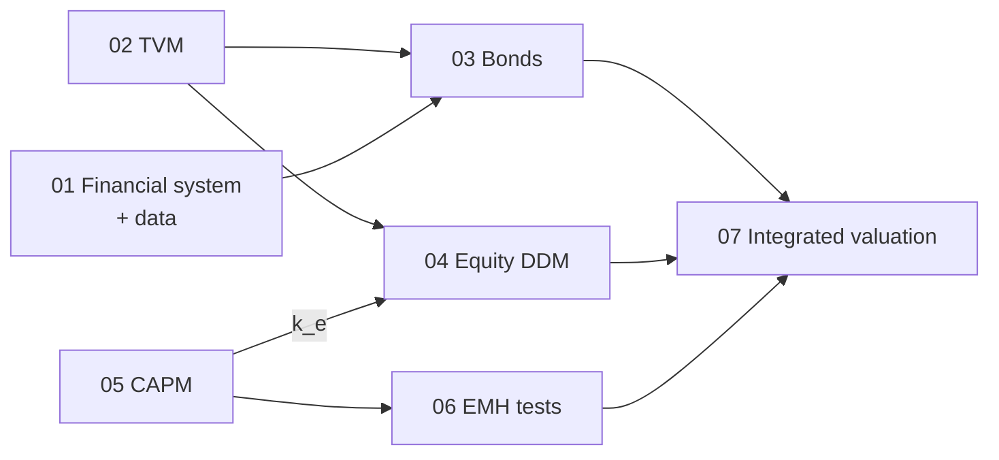

# 07 — Implementation Spec for Claude Code

This is the build contract. Read `00_README.md` first, then the concept file for the notebook you are building.

---

## 7.1 Target repo layout

```
bond-debt/
├── docs/                     # this spec pack
├── data/
│   ├── CorporateAverageSpread(duration)_2026-08-26.xlsx   # existing
│   ├── CorporateAverageSpread(ttm)_2026-08-26.xlsx        # existing
│   └── raw/  processed/      # new downloads (BOT rates, SET prices) cached as parquet/csv
├── valuation/                # importable package — all math lives here
│   ├── __init__.py
│   ├── tvm.py                # 02
│   ├── bonds.py              # 03  (refactor of pv.ipynb)
│   ├── spreads.py            # 01 §1.5, 03 §3.10
│   ├── equity.py             # 04
│   ├── returns.py            # 05 §5.1
│   ├── capm.py               # 05
│   ├── emh.py                # 06
│   └── data.py               # loaders + cache
├── tests/
│   └── test_*.py             # one per module; values from §7.5
├── notebooks/
│   ├── 01_financial_system.ipynb
│   ├── 02_tvm.ipynb
│   ├── 03_bonds.ipynb
│   ├── 04_equity_ddm.ipynb
│   ├── 05_capm.ipynb
│   ├── 06_emh_tests.ipynb
│   └── 07_integrated_valuation.ipynb
├── pv.ipynb                  # existing — keep; later import from valuation.bonds
└── valuation.ipynb           # existing (empty) — use as 07 or delete after confirming with Kim
```

## 7.2 Coding conventions

- **Rates are decimals** (0.05, not 5). Spreads in files are in **bp**; convert with `/10_000` at the loader boundary only.
- **Time:** functions take `t` in **years**. Bond functions keep the existing `pv.ipynb` signature (`months`, `freq`) for continuity and convert internally. `freq` = coupons per year = compounding frequency $m$.
- **Cash-flow timing:** end of period unless `due=True`.
- **Root finding:** `scipy.optimize.brentq` with an explicit bracket. Fall back to bisection (the existing `irr()` style) if the bracket fails. Default tolerance `1e-12`.
- **Vectorize** with NumPy; return Python `float` for scalars.
- **Validate inputs:** raise `ValueError` for `ke <= g`, `1 + y/m <= 0`, negative periods, or empty cash flows.
- **Docstrings** cite the concept file and equation, e.g. `"""Gordon growth model — docs/04 §4.4, Mishkin eq. (5)."""`.
- **Notebooks:** contain no math definitions, only `from valuation import ...`. Each starts with a markdown cell linking its concept file and ends with an "Assertions" cell that re-checks the key test values.
- **Charts:** matplotlib, one idea per chart, labeled axes with units, and a source note for data.
- **Libraries:** numpy, pandas, scipy, statsmodels, matplotlib, openpyxl (for the spread files), yfinance (optional, for SET prices).

## 7.3 Notebook roadmap



| NB | Goal | Key outputs | Done when |
|---|---|---|---|
| 01 | Data context | Thai rates chart, term and bank spreads, spread heatmap | Loaders work offline from cached files |
| 02 | TVM engine | Timeline, PV decay, EAR vs m, mortgage schedule | All §7.5 TVM tests pass |
| 03 | Bonds | Tables 1–2, price–yield + duration/convexity, return vs YTM shocks, real rates, corporate pricing by rating | Tables reproduce exactly |
| 04 | Equity | One-period, Gordon, two-stage, sensitivity heatmap, implied g for a SET stock | Shipline and Mishkin values reproduce |
| 05 | CAPM | Betas, SML plot, alpha, risk decomposition, $k_e$ export | Synthetic β test passes |
| 06 | EMH | Weak-form battery, MA backtest, event study | Synthetic tests behave as specified |
| 07 | Integrated | One stock + one bond valued end-to-end: data → CAPM → DDM; gov curve + spread → bond price; compare with market | A one-page summary table |

## 7.4 Data sources (to fetch; cache under `data/raw/`)

| Data | Source | Notes |
|---|---|---|
| Policy rate, interbank, deposit/MLR, gov yields | Bank of Thailand statistics / BOT API portal | Monthly is enough for NB01 |
| Gov. yield curve, corporate spreads | ThaiBMA | Spread files already in `data/` (as of 2026-08-26) |
| SET index / stock prices | SET, or `yfinance` (`^SET.BK`, `PTT.BK`, …) | yfinance prices are **not** total return. Use adjusted close, or add dividends manually. Note this limitation |
| Inflation (CPI) | Ministry of Commerce / BOT | For ex post real rates |

If a download fails or the network is blocked, generate **synthetic data** with a fixed seed so every notebook still runs, and print a clear banner saying so.

## 7.5 Master test table (all values verified numerically)

Put these in `tests/`. Tolerance: `abs=0.01` for currency amounts and `abs=1e-4` for rates, unless stated otherwise.

### TVM (`tvm.py`)
| Function | Inputs | Expected |
|---|---|---|
| `fv` | 100, 0.10, 2 | 121.00 |
| `pv` | 250, 0.15, 2 | 189.04 |
| `pv` | 100, 0.067, 20 | 27.33 |
| `pv` | 100, −0.0005, 10 | 100.50 |
| `pv` (monthly) | 5,000,000, 0.06, 10, m=12 | 2,748,163.67 |
| `annuity_pv(due=True)` | 1e6, 0.10, 20 | 9,364,920.09 |
| `annuity_payment` | 100,000, 0.07, 20 | 9,439.29 |
| `annuity_payment` | 800,000, 0.0525/12, 360 | 4,417.63 |
| `annuity_rate` | 1,000, 85.81, 25 | 0.0700 |
| `perpetuity_pv` | 100, 0.10 | 1,000 |
| `annualize` | 0.002, c=52 | 0.1095 |
| `annualize` | 0.20, c=2/3 | 0.1292 |
| `log_return` | 30 → 34.50 | 0.139762 (abs 1e-6) |
| `forward_rate` | z1 0.02, z2 0.03 | 0.040098 |

### Bonds (`bonds.py`)
| Function | Inputs | Expected |
|---|---|---|
| `bond_price` | F 1000, c 10%, 8y, y 12.25%, annual | 889.20 |
| `bond_ytm` | prices 1200/1100/1000/900/800; F 1000, c 10%, 10y | 0.0713 / 0.0848 / 0.1000 / 0.1175 / 0.1381 |
| `bond_price` | F 100, c 2%, 7y, y 2% | 100.00 |
| `bond_ytm` | P 93.091, F 100, c 2%, 5y | 0.03532 |
| `bond_price` | F 100, c 6.7%, 20y, y 7.7%, freq 2 | 89.88 |
| `zero_price` | 100, 0.067, 20, m=2 | 26.77 |
| `zero_ytm` | 900 → 1000, 1y | 0.1111 |
| `zero_ytm` | 22.68224 → 100, 20y | 0.0770 |
| `current_yield` | C 100, F 1000, 10% coupon, 20y at y 12% → P 850.61 | 0.1176 |
| `table2()` | defaults | next-year prices 503 / 516 / 597 / 741 / 917 / 1000; returns −39.7 / −38.4 / −30.3 / −15.9 / +1.7 / +10.0 % |
| `holding_period_return` | 1000 → 1200, income 100 | 0.30 |
| `rollover_value` | 1000, [0.10, 0.20] | 1,320 → annualized 0.1489 |
| `duration` | F 1000, c 10%, 10y, y 10% | Mac 6.7590, Mod 6.1446, Conv 52.79 |
| `real_rate(exact=False)` | 0.08, 0.10 | −0.02 |
| `after_tax_real` | 0.10, 0.30, 0.05 | 0.02 |
| `real_rate(exact=True)` | 0.024, 0.02 | 0.0039 |
| Existing `pv.ipynb` regression | par 1e6, 3%, 36m, q, 5%, tax 15% | Same output as before refactor (snapshot test) |

### Equity (`equity.py`)
| Function | Inputs | Expected |
|---|---|---|
| `one_period_price` | D1 0.16, P1 60, ke 0.12 | 53.71 |
| `ddm_explicit` | terminal 50 at t=75, ke 0.12 | 0.0102 (abs 1e-4) |
| `gordon_price` | d1 2, g 0.03, ke 0.15 / 0.12 / 0.10 | 16.67 / 22.22 / 28.57 |
| `gordon_price` | d0 1.50, g 0.06, ke 0.15 | 17.67 |
| `gordon_price` | d1 1.50, g 0, ke 0.15 | 10.00 |
| `two_stage_ddm` | d0 1.5, gS 0.06, n 3, gL 0 / 0.02 / 0.04 / 0.06, ke 0.15 | 11.66 / 13.05 / 14.94 / 17.67 |
| `gordon_implied_return` | P 63, D1 1.76, g 0.04 | 0.0679 |
| `gordon_implied_growth` | P 63, D1 1.76, ke 0.07 | 0.0421 |
| `justified_forward_pe` | payout 0.70, ke 0.09, g 0.045 | 15.56 |
| `gordon_price` | ke ≤ g | raises `ValueError` |

### Returns / CAPM (`returns.py`, `capm.py`)
| Function | Inputs | Expected |
|---|---|---|
| `capm_required_return` | rf 0.025, β 1.2, rm 0.08 | 0.091 |
| `leveraged_return` | Rp 0.08, VB/VE = 3/7, rD 0.05 | 0.0929 |
| `estimate_beta` | synthetic (05 §5.5), seed 42 | β within 1.3 ± 0.05 |
| `geometric_mean` | [0.10, −0.10] | −0.00501 |

### EMH (`emh.py`) — see 06 §6.7 for the synthetic expectations.

## 7.6 Prompts to paste into Claude Code

1. *"Read docs/00_README.md and docs/07_implementation_spec.md. Scaffold the `valuation/` package and `tests/` per §7.1–7.2. Implement `tvm.py` from docs/02 and make its tests in §7.5 pass."*
2. *"Refactor pv.ipynb's functions into valuation/bonds.py per docs/03, keep the same outputs (add a snapshot test), add YTM, duration, table2, and real-rate functions, and make §7.5 bond tests pass. Then build notebooks/03_bonds.ipynb."*
3. *"Implement equity.py per docs/04 and build notebooks/04_equity_ddm.ipynb."*
4. *"Implement returns.py and capm.py per docs/05 and build notebooks/05_capm.ipynb using SET data (fall back to synthetic data if download fails)."*
5. *"Implement emh.py per docs/06 and build notebooks/06_emh_tests.ipynb."*
6. *"Build notebooks/07_integrated_valuation.ipynb combining 03–06 for one SET stock and one Thai corporate bond."*

Commit after each step, with tests green.
